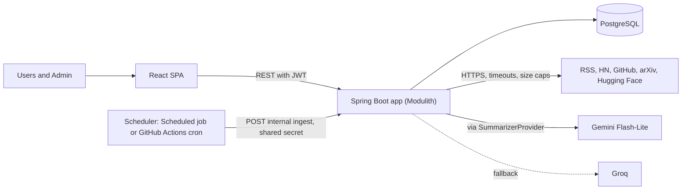
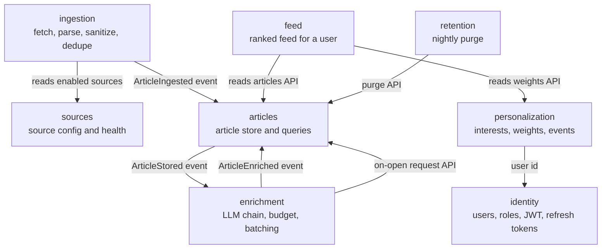
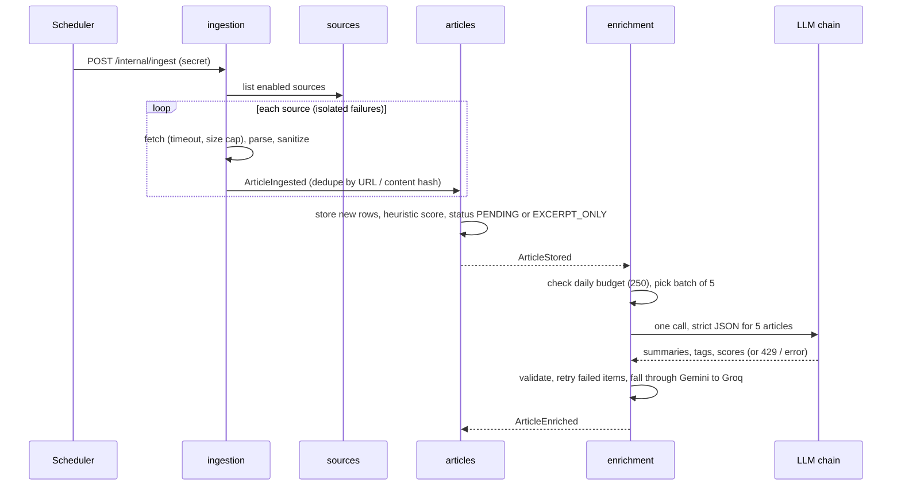
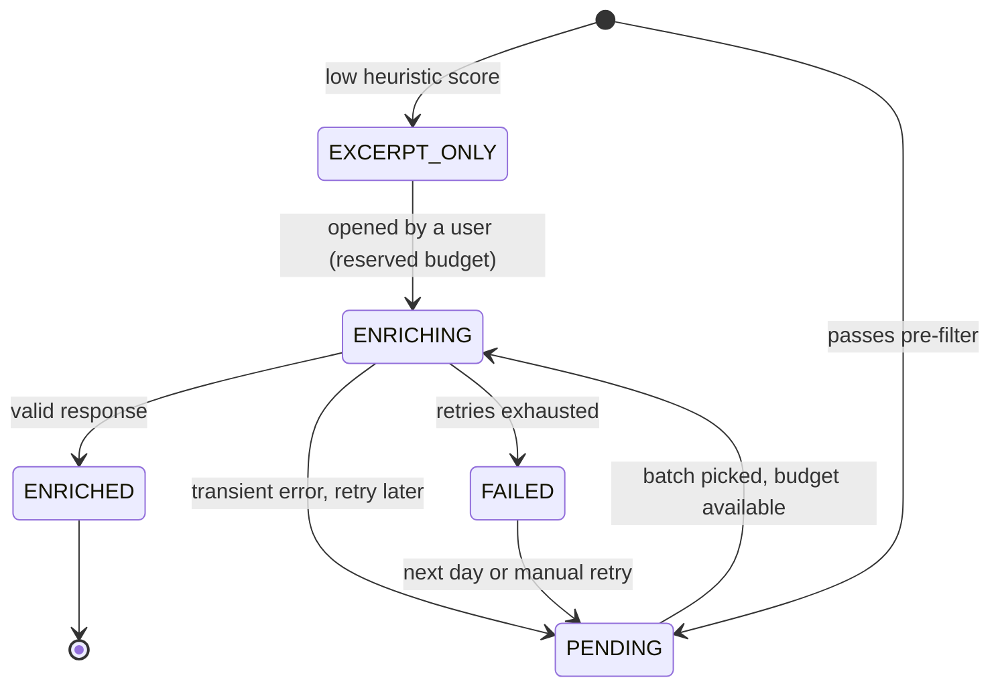
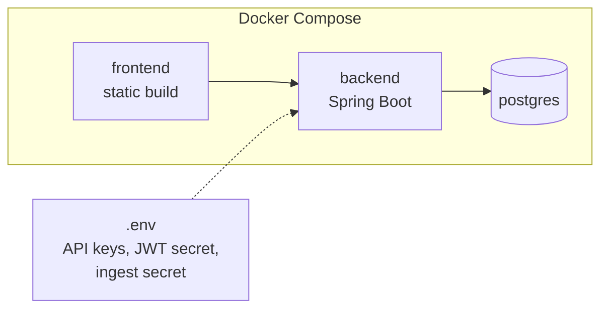

# Architecture

_Status: draft for review, 2026-11-11. Inputs: [PRD](PRD.md), [Technology selection](TECH-SELECTION.md). Detailed schema and API design is a separate deliverable._

## 1. Style
A **modular monolith**: one Spring Boot deployable, split into Spring Modulith modules with enforced boundaries, backed by one PostgreSQL database. A React SPA talks to it over REST. No broker, no microservices.

Rules (enforced by `ApplicationModules.verify()` in tests):
- A module exposes only its root package (public API and events). Sub-packages are internal.
- Modules interact through published APIs or application events, never through another module's internals or tables.
- Each module owns its tables. Cross-module reads go through the owning module's API.

## 2. System context


## 3. Modules and dependencies

Notes:
- `identity` is a leaf that other modules reference only by user id (no entity sharing).
- `articles` owns article rows, including enrichment status fields. `enrichment` writes results back through `articles`' API or by event, not by touching its tables.
- The exact event and API names are decided when implementing; Modulith tests keep the graph acyclic.

## 4. Ingestion and enrichment flow


## 5. Article enrichment states

The state lives in a column on the article row, so a restart just resumes work. No queue infrastructure is needed.

## 6. Key design decisions
| Concern | Decision |
|---|---|
| Async work | In-process worker polling for `PENDING` rows; `@Scheduled` plus Modulith events. Idempotent, safe to re-run |
| Dedupe | Canonical URL, with content hash as fallback; unique index enforces it |
| LLM budget | Persisted daily counter (250 across providers), checked before every call including retries; ~50 reserved for on-open |
| Provider chain | `SummarizerProvider` interface; a `ProviderChain` tries Gemini then Groq, handles 429 with backoff |
| Prompt safety | Each article in its own delimited block, output validated against a JSON schema, output never drives actions |
| Feed ranking | Score = article relevance + the user's tag weights + recency decay. Computed at query time for 2-5 users |
| Personalization | Click/save events adjust per-user tag weights (small increments, decayed) |
| Auth | Access JWT (~15 min) + rotating refresh token (HttpOnly cookie, hashed in Postgres). `/internal/ingest` uses a separate shared secret |
| Content safety | Sanitize HTML on ingest, bound sizes and timeouts, never render raw feed HTML |
| Retention | Nightly purge of articles past the window; saved articles are kept (PRD open question, assumed) |
| Failure isolation | One failing source or one failing batch never stops the rest |

## 7. Backend package layout (indicative)
```
com.intellhub
├── identity/          # root = public API, events
│   └── internal/      # controllers, entities, security config
├── sources/
├── ingestion/
├── articles/
├── enrichment/
│   └── internal/      # providers (gemini, groq), budget, batching
├── personalization/
├── feed/
├── retention/
└── shared/            # minimal: error model, clock, config properties
```
Packages are by module, not by layer. `shared` stays small and holds no business logic.

## 8. Frontend structure (indicative)
React + Vite, organized by feature (`auth`, `feed`, `article`, `interests`, `admin`), with an `api` layer and JSDoc `@typedef` for shapes. UI design comes first (PROGRESS.md decision).

## 9. Deployment (MVP)

Local only for now. Secrets come from environment variables. The same Compose file should run on a plain VPS later.

## 10. Cross-cutting
- **Observability:** Actuator health, structured logs, counters for LLM calls, budget remaining and per-source ingestion failures.
- **Testing:** Modulith `verify()`, Testcontainers Postgres, fake `SummarizerProvider` and a fake feed server. Real providers are never called in tests.
- **Errors:** one consistent error response model from the API.
- **Config:** typed `@ConfigurationProperties` per module.

## 11. Risks
| Risk | Mitigation |
|---|---|
| Free LLM limits shrink | Budget cap, batching, lazy enrichment, graceful degradation, provider chain |
| Prompt injection from feeds | Delimited blocks, schema validation, no action from output |
| Rome is in reduced maintenance | Behind our own `FeedParser` interface |
| Modulith / Boot 4 version drift | Pin versions; confirm the compatibility matrix at skeleton time |
| Module boundaries erode | `verify()` runs in CI on every build |

## 12. Open items
1. Exact event and API names per module (decided during implementation).
2. Retention rule for saved articles (confirm).
3. Whether `enrichment` writes back by event or through the `articles` API (pick one and apply it consistently).
