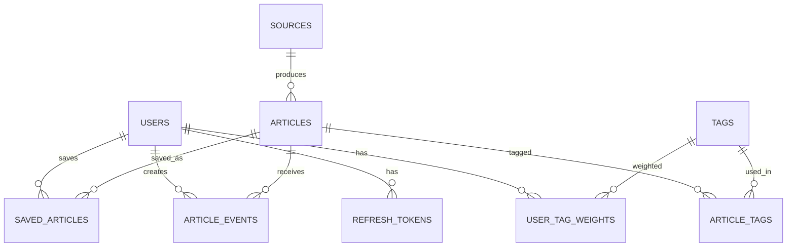

# Database and API Design

_Status: draft for review, 2026-11-11. Inputs: [PRD](PRD.md), [Architecture](ARCHITECTURE.md)._

## 1. Conventions
- PostgreSQL, UUID primary keys (generated by the app), `timestamptz` for all times (UTC), `snake_case` names.
- Schema changes only through Flyway migrations. Never edit an applied migration.
- Each module owns its tables. Foreign keys to another module's table are allowed in the database for integrity, but JPA entities never hold associations across modules; they store the other module's id as a plain value.
- Enumerations are stored as text with a `CHECK` constraint (easier to migrate than native enums).

## 2. Entity overview

## 3. Tables by module

### identity
**users**: `id`, `email` (unique, lowercase), `password_hash`, `role` (USER, ADMIN), `enabled`, `created_at`.
**refresh_tokens**: `id`, `user_id` (FK), `family_id`, `token_hash` (unique, SHA-256 of the token), `expires_at`, `revoked_at`, `replaced_by`, `created_at`. Replay of a revoked token revokes the whole `family_id`.

### sources
**sources**: `id`, `type` (RSS, HN, GITHUB_RELEASES, ARXIV, HUGGINGFACE), `name`, `url`, `config` (jsonb, e.g. HN story type or GitHub repo), `enabled`, `last_fetched_at`, `last_status` (OK, FAILED), `last_error`, `consecutive_failures`, `created_at`. Unique on (`type`, `url`).

### articles
**articles**: `id`, `source_id` (FK), `canonical_url` (unique), `content_hash`, `title`, `author`, `published_at`, `ingested_at`, `excerpt`, `content_sanitized`, `category` (AI_ML, SOFTWARE_ENGINEERING, INDUSTRY_STARTUPS), `heuristic_score`, `relevance_score`, `summary`, `status` (EXCERPT_ONLY, PENDING, ENRICHING, ENRICHED, FAILED), `enrichment_attempts`, `enriched_at`, `enriched_by` (provider name).
**tags**: `id`, `name` (unique, lowercase), `kind` (TAXONOMY, FREE).
**article_tags**: (`article_id`, `tag_id`) primary key, `origin` (HEURISTIC, LLM).

### personalization
**user_tag_weights**: (`user_id`, `tag_id`) primary key, `explicit_weight` (set by the user's interests), `learned_weight` (from clicks and saves), `updated_at`.
**article_events**: `id`, `user_id`, `article_id`, `type` (CLICK, SAVE, UNSAVE), `created_at`. Kept short-term and purged with articles.
**saved_articles**: (`user_id`, `article_id`) primary key, `saved_at`. Saved articles are exempt from the purge.

### enrichment
**llm_usage**: (`day`, `provider`) primary key, `calls`, `failures`. The daily budget is the sum of `calls` for `day`, checked before every call. Updates are atomic (`UPDATE ... SET calls = calls + 1 WHERE ... AND total < budget`) so concurrent workers cannot overspend.

## 4. Indexes
| Table | Index | Purpose |
|---|---|---|
| articles | unique (`canonical_url`) | Dedupe |
| articles | (`content_hash`) | Fallback dedupe, skip re-enrichment |
| articles | (`status`, `ingested_at`) | Worker picks pending rows |
| articles | (`published_at` desc) | Feed ordering, retention purge |
| articles | GIN on a `tsvector` of title and summary | Full-text search |
| article_tags | (`tag_id`, `article_id`) | Filter by tag |
| article_events | (`user_id`, `created_at`) | Learning from recent events |
| refresh_tokens | (`family_id`) | Family revocation |

## 5. Flyway migration plan
| Version | Content |
|---|---|
| V1__baseline.sql | Baseline (M0): proves Flyway runs |
| V2__identity.sql | users, refresh_tokens (M1, done) |
| V3__sources.sql | sources (M2, done) |
| V4__articles.sql | articles with unique canonical URL and content hash, indexes, search vector (M3, done) |
| V5__reading_state.sql | saved_articles, article_events, and the search index over title, excerpt and summary (M4, done) |
| V6__tags.sql | tags, article_tags, `claimed_at` and `enrichment_requested_at` on articles (M5, done) |
| V7__enrichment_usage.sql | llm_usage (M5, done) |
| V8__personalization.sql | user_tag_weights (M7, done) |

The curated tags are not a migration: a startup seeder creates them from `taxonomy.json`, so they can be reviewed and edited without one.

First admin user comes from `ADMIN_EMAIL` and `ADMIN_PASSWORD` on first start, only while no users exist, not from a migration, so no credentials live in the repo.

## 6. Retention purge
Nightly (when `RETENTION_ENABLED=true`, or by hand): delete `articles` published before the retention window (7 days by default), excluding any a user has saved; their `article_events` and tag links go with them by cascade. Each batch (500) is one transaction: the expired articles are locked `FOR UPDATE`, personalization says which are saved by anyone, and the rest are deleted, so a save made at the same moment cannot be lost or left half-done. Expired refresh tokens (expired for more than one day) are deleted in the same job; revoked tokens that have not expired are kept, because replaying one is how token reuse is detected. Tags, learned weights and `llm_usage` are not touched. The window must not be shorter than the ingestion age limit (`intellhub.ingestion.max-age`, also 7 days) or articles would be purged and fetched again; startup refuses that.

## 7. REST API
Base path `/api/v1`. JSON. Auth via `Authorization: Bearer <access JWT>`, except where stated. Errors use one shape: `{ "code", "message", "details" }`. List endpoints are paginated with `page` and `size` (size capped).

### Auth (public)
| Method | Path | Notes |
|---|---|---|
| POST | /api/v1/auth/login | Email and password. Returns access token; sets refresh cookie |
| POST | /api/v1/auth/refresh | Uses the refresh cookie; rotates it |
| POST | /api/v1/auth/logout | Revokes the refresh token |

### Current user
| Method | Path | Notes |
|---|---|---|
| GET | /api/v1/me | Profile and role |
| PUT | /api/v1/me/password | Change password |
| GET | /api/v1/me/interests | The caller's chosen tags and the tags with a noticeable learned weight, strongest first, at most 100: `[{tag, explicit, learned}]` (learned is already faded) |
| PUT | /api/v1/me/interests | Replace the chosen set: `{"interests":[{"tag":"llm","weight":1.0}]}`, at most 50, tag must be valid and exist (400 `UNKNOWN_TAG`), weight 0.1 to 1 (default 1). A dropped tag loses its chosen weight but keeps what was learned. 204 |

### Feed and articles (USER)
| Method | Path | Notes |
|---|---|---|
| GET | /api/v1/feed | Ranked for the caller by default (`sort=relevance`), or `sort=newest` for newest first (anything else is a 400); see the ranking formula below. Query: `page` (from 0), `size` (1-50, default 20), `q` (web-style full text over title, excerpt and summary, at most 200 characters), `source` (uuid), `category` (AI_ML, SOFTWARE_ENGINEERING, INDUSTRY_STARTUPS), `saved` (true shows only the caller's saved articles). `tag` (a tag name). Returns `{items, page, size, totalElements, totalPages}`; each item has id, sourceId, sourceName, url, title, author, publishedAt, excerpt, summary, category, status and `saved` (the caller's own). Bad parameters are 400 `VALIDATION_FAILED` |
| GET | /api/v1/articles/{id} | The item fields plus `contentSanitized`, the only field that may be rendered as HTML (everything else is text). 404 `ARTICLE_NOT_FOUND`. Opening an article that the pre-filter skipped (`EXCERPT_ONLY`) queues it for enrichment, first in line and using the reserved budget; the response does not wait, and shows `status` `PENDING` |
| POST | /api/v1/articles/{id}/click | Records a click event, 204. A repeat click on the same article within 10 seconds counts once |
| PUT | /api/v1/articles/{id}/save | Save, idempotent, 204. Only ever changes the caller's own state |
| DELETE | /api/v1/articles/{id}/save | Unsave, idempotent, 204 |
| GET | /api/v1/tags | `limit` 1-200 (default 100). The curated tags first (even unused ones), then the most used free tags, each with `name`, `kind` and `articleCount` |

### Admin (ADMIN)
| Method | Path | Notes |
|---|---|---|
| GET, POST | /api/v1/admin/users | List, create |
| PATCH | /api/v1/admin/users/{id} | Change role or enabled |
| GET, POST | /api/v1/admin/sources | List with health fields, create. Each type may only use its own address: `RSS` any public feed; `HN` exactly `https://hn.algolia.com/api/v1/search?tags=front_page&hitsPerPage=30`; `HUGGINGFACE` exactly `https://huggingface.co/api/daily_papers`; `GITHUB_RELEASES` `https://github.com/<owner>/<repo>/releases.atom`; `ARXIV` `https://rss.arxiv.org/(rss\|atom)/<category>`. Config: `maxEntries` 1-100 (all types), `minPoints` 0-1000 (HN). Errors: 400 `INVALID_SOURCE_URL` / `INVALID_SOURCE_CONFIG` / `VALIDATION_FAILED`, 409 `SOURCE_EXISTS` |
| PATCH, DELETE | /api/v1/admin/sources/{id} | PATCH changes only `name`, `enabled` and `config`; `type` and `url` are fixed (any attempt to send them is ignored). DELETE is permanent, disabling is the normal way to stop a source. 404 `SOURCE_NOT_FOUND` |
| GET | /api/v1/admin/status | Read-only, no input. `{sources:{total,enabled,failing,neverFetched,items:[{id,name,type,enabled,lastFetchedAt,lastStatus,lastError,consecutiveFailures}]}, articles:{total,byStatus,oldestPublishedAt}, enrichment:{enabled,providers,day,budget:{daily,reservedForReaders,usedToday,remainingForReaders,remainingForBackground},usageToday:[{provider,calls,failures}]}, retention:{scheduled,windowDays,lastRun}}`. No addresses, settings, keys or article text. `lastRun` is null until a purge has run since the app started |
| POST | /api/v1/admin/retention/purge | Runs the purge by hand. `dryRun` defaults to true (nothing is deleted); only the exact words `true` and `false` are accepted (anything else is a 400, so `0`, `no` or `off` cannot turn into a real deletion). Returns `{dryRun, articlesExpired, articlesKeptBecauseSaved, articlesDeleted, tokensDeleted, durationMillis, finishedAt}`. 409 `RETENTION_RUNNING` if a purge is already running |

### Internal
| Method | Path | Notes |
|---|---|---|
| POST | /internal/ingest | Header `X-Ingest-Token` with `INGEST_SECRET` (32+ characters), never a JWT. Runs one ingestion and returns 200 with a summary (counts, source names, fixed error texts), or 409 `INGEST_RUNNING` if a run is already in progress. Every refusal is the same 403, including when no secret is configured. Not exposed through the frontend |

## 8. Security notes
- BCrypt for passwords; constant-time secret comparison for `/internal/ingest`.
- Refresh cookie: HttpOnly, SameSite, Secure when not on localhost.
- Rate-limit login attempts.
- The API never returns raw feed HTML. Only sanitized content and plain-text summaries are returned, and the React app renders them as text.
- Method-level authorization (`@PreAuthorize`) on admin endpoints, with tests that a USER gets 403.

## 9. Open items
1. ~~Exact ranking formula and weight increments~~ Decided (M7), all constants in `RankingSql` and `Weights`:
   - `score = 0.4 * relevance + 0.4 * affinity + 0.2 * recency`, each from 0 to 1.
   - relevance is `relevance_score`, else half the cheap `heuristic_score`, else 0. affinity is `1 - exp(-s)` where `s` is the sum of the reader's weights over the article's tags. recency is `0.5 ^ (age / 72 hours)`.
   - A tag's weight is the chosen weight plus the learned weight faded by half every 14 days. A click adds 0.05 to each of the article's tags, a save 0.15, an unsave takes 0.15 back; learned stays between 0 and 1.
   - Computed at query time, with one "now" per request. Between page requests the order can shift slightly as time passes.
2. ~~Retention window length~~ Decided (M9): 7 days; saved articles are kept for as long as any user has them saved.
3. ~~Offset or cursor pagination~~ Decided (M4): offset pages. New articles arriving mid-scroll can shift items by one; accepted at this scale.
4. ~~Search scope~~ Decided (M4): title, excerpt and summary, not full content.
