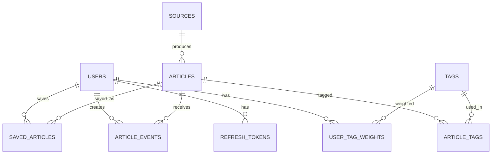

# Database and API Design

_Status: draft for review, 2026-11-11. Inputs: [PRD](PRD.md), [Architecture](ARCHITECTURE.md)._

## 1. Conventions
- PostgreSQL, UUID primary keys (generated by the app), `timestamptz` for all times (UTC), `snake_case` names.
- Schema changes only through Flyway migrations. Never edit an applied migration.
- Each module owns its tables. Foreign keys to another module's table are allowed in the database for integrity, but JPA entities never hold associations across modules; they store the other module's id as a plain value.
- Enumerations are stored as text with a `CHECK` constraint (easier to migrate than native enums).

## 2. Entity overview

## 3. Tables by module

### identity
**users**: `id`, `email` (unique, lowercase), `password_hash`, `role` (USER, ADMIN), `enabled`, `created_at`.
**refresh_tokens**: `id`, `user_id` (FK), `family_id`, `token_hash` (unique, SHA-256 of the token), `expires_at`, `revoked_at`, `replaced_by`, `created_at`. Replay of a revoked token revokes the whole `family_id`.

### sources
**sources**: `id`, `type` (RSS, HN, GITHUB_RELEASES, ARXIV, HUGGINGFACE), `name`, `url`, `config` (jsonb, e.g. HN story type or GitHub repo), `enabled`, `last_fetched_at`, `last_status` (OK, FAILED), `last_error`, `consecutive_failures`, `created_at`. Unique on (`type`, `url`).

### articles
**articles**: `id`, `source_id` (FK), `canonical_url` (unique), `content_hash`, `title`, `author`, `published_at`, `ingested_at`, `excerpt`, `content_sanitized`, `category` (AI_ML, SOFTWARE_ENGINEERING, INDUSTRY_STARTUPS), `heuristic_score`, `relevance_score`, `summary`, `status` (EXCERPT_ONLY, PENDING, ENRICHING, ENRICHED, FAILED), `enrichment_attempts`, `enriched_at`, `enriched_by` (provider name).
**tags**: `id`, `name` (unique, lowercase), `kind` (TAXONOMY, FREE).
**article_tags**: (`article_id`, `tag_id`) primary key, `origin` (HEURISTIC, LLM).

### personalization
**user_tag_weights**: (`user_id`, `tag_id`) primary key, `explicit_weight` (set by the user's interests), `learned_weight` (from clicks and saves), `updated_at`.
**article_events**: `id`, `user_id`, `article_id`, `type` (CLICK, SAVE, UNSAVE), `created_at`. Kept short-term and purged with articles.
**saved_articles**: (`user_id`, `article_id`) primary key, `saved_at`. Saved articles are exempt from the purge.

### enrichment
**llm_usage**: (`day`, `provider`) primary key, `calls`, `failures`. The daily budget is the sum of `calls` for `day`, checked before every call. Updates are atomic (`UPDATE ... SET calls = calls + 1 WHERE ... AND total < budget`) so concurrent workers cannot overspend.

## 4. Indexes
| Table | Index | Purpose |
|---|---|---|
| articles | unique (`canonical_url`) | Dedupe |
| articles | (`content_hash`) | Fallback dedupe, skip re-enrichment |
| articles | (`status`, `ingested_at`) | Worker picks pending rows |
| articles | (`published_at` desc) | Feed ordering, retention purge |
| articles | GIN on a `tsvector` of title and summary | Full-text search |
| article_tags | (`tag_id`, `article_id`) | Filter by tag |
| article_events | (`user_id`, `created_at`) | Learning from recent events |
| refresh_tokens | (`family_id`) | Family revocation |

## 5. Flyway migration plan
| Version | Content |
|---|---|
| V1__identity.sql | users, refresh_tokens |
| V2__sources.sql | sources |
| V3__articles_tags.sql | articles, tags, article_tags, indexes, search vector |
| V4__personalization.sql | user_tag_weights, article_events, saved_articles |
| V5__enrichment_usage.sql | llm_usage |
| V6__seed_taxonomy.sql | Initial taxonomy tags (idempotent inserts) |

First admin user comes from environment variables on first start, not from a migration, so no credentials live in the repo.

## 6. Retention purge
Nightly: delete `article_events` and `articles` older than the retention window, excluding articles present in `saved_articles`. Delete in batches to keep transactions short. Expired and revoked refresh tokens are deleted in the same job.

## 7. REST API
Base path `/api/v1`. JSON. Auth via `Authorization: Bearer <access JWT>`, except where stated. Errors use one shape: `{ "code", "message", "details" }`. List endpoints are paginated with `page` and `size` (size capped).

### Auth (public)
| Method | Path | Notes |
|---|---|---|
| POST | /api/v1/auth/login | Email and password. Returns access token; sets refresh cookie |
| POST | /api/v1/auth/refresh | Uses the refresh cookie; rotates it |
| POST | /api/v1/auth/logout | Revokes the refresh token |

### Current user
| Method | Path | Notes |
|---|---|---|
| GET | /api/v1/me | Profile and role |
| PUT | /api/v1/me/password | Change password |
| GET | /api/v1/me/interests | Interest tags with weights |
| PUT | /api/v1/me/interests | Replace the interest set |

### Feed and articles (USER)
| Method | Path | Notes |
|---|---|---|
| GET | /api/v1/feed | Ranked. Filters: `category`, `tag`, `source`, `saved`, `q` (search) |
| GET | /api/v1/articles/{id} | Detail. Triggers lazy enrichment if not enriched, within the reserved budget |
| POST | /api/v1/articles/{id}/click | Records a click event |
| PUT | /api/v1/articles/{id}/save | Save |
| DELETE | /api/v1/articles/{id}/save | Unsave |
| GET | /api/v1/tags | Tag list for filters and interests |

### Admin (ADMIN)
| Method | Path | Notes |
|---|---|---|
| GET, POST | /api/v1/admin/users | List, create |
| PATCH | /api/v1/admin/users/{id} | Change role or enabled |
| GET, POST | /api/v1/admin/sources | List, create |
| PATCH, DELETE | /api/v1/admin/sources/{id} | Edit, disable, remove |
| GET | /api/v1/admin/status | Source health, enrichment status counts, LLM budget used today |

### Internal
| Method | Path | Notes |
|---|---|---|
| POST | /internal/ingest | Shared-secret header, not a JWT. Returns 202 with a run summary. Not exposed through the frontend |

## 8. Security notes
- BCrypt for passwords; constant-time secret comparison for `/internal/ingest`.
- Refresh cookie: HttpOnly, SameSite, Secure when not on localhost.
- Rate-limit login attempts.
- The API never returns raw feed HTML. Only sanitized content and plain-text summaries are returned, and the React app renders them as text.
- Method-level authorization (`@PreAuthorize`) on admin endpoints, with tests that a USER gets 403.

## 9. Open items
1. Exact ranking formula and weight increments (defined when implementing `feed` and `personalization`, with unit tests).
2. Retention window length: 7 or 14 days (PRD says 1-2 weeks).
3. Whether `/api/v1/feed` uses offset or cursor pagination. Offset is simpler and fine at this scale; cursor avoids shifting results as new articles arrive.
4. Search scope: title and summary only, or full content.
